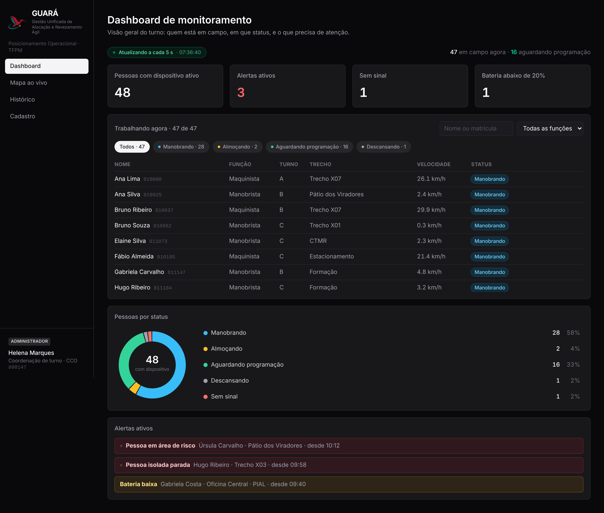
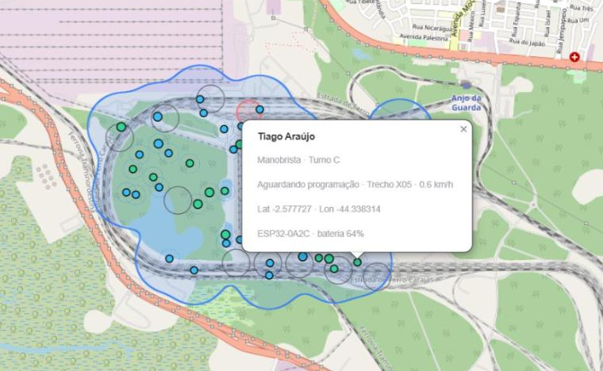
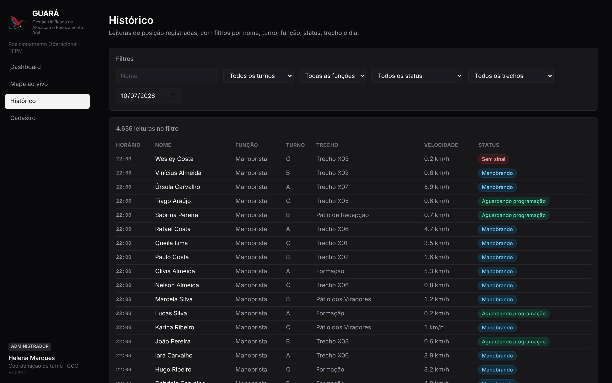
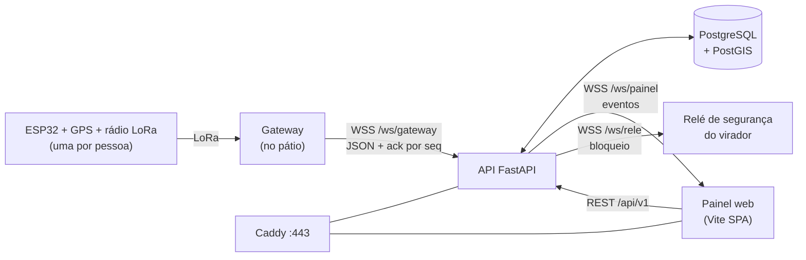

<div align="center">


# GUARÁ — Posicionamento Operacional Inteligente

**Gestão Unificada de Alocação e Revezamento Ágil**

Saber, em tempo real, onde está cada maquinista e manobrista no pátio — e quem chega mais rápido a cada frente de trabalho.


*Desafio **KaizenDO** · Vale · Terminal Ferroviário de Ponta da Madeira (TFPM), São Luís/MA*

</div>

---

## Demonstração

https://github.com/user-attachments/assets/99c044fc-238a-470b-b75a-42dcc65f4911

> Do dispositivo no pátio até a tela do painel. Os nomes e as posições mostrados são **fictícios**.

<table>
  <tr>
    <td align="center"><b>Dashboard</b></td>
    <td align="center"><b>Mapa ao vivo</b></td>
    <td align="center"><b>Histórico</b></td>
  </tr>
  <tr>
    <td></td>
    <td></td>
    <td></td>
  </tr>
</table>

## O problema

Cerca de **50 maquinistas e manobristas por turno** trabalham em **13 km de pátio**, e ninguém sabe com precisão onde cada um está. A escolha de quem acionar e o revezamento dependem da memória de quem coordena, e os vagões ficam parados esperando gente chegar.

## A solução

Cada pessoa leva uma tag **ESP32** com GPS e rádio. Os gateways enviam a latitude, a longitude e a velocidade de todos à API, que guarda tudo e empurra ao painel. Com isso o sistema:

- 📍 **mostra onde está cada pessoa**, num mapa do pátio atualizado ao vivo;
- ⚡ **recomenda quem chega mais rápido** a cada frente de trabalho *(proposto)*;
- 🕑 **guarda o histórico** de posições do turno;
- 🛑 **bloqueia o virador** quando há alguém na área de basculamento, como extra de segurança *(proposto)*. Se o sinal de quem estava na área se perde, o sistema **assume que a pessoa continua lá** e mantém o bloqueio.

## O que existe hoje

| Parte | Situação |
|---|---|
| Painel web: dashboard, mapa ao vivo, histórico e cadastro | ✅ Implementado como **protótipo visual**, com dados ilustrativos |
| Tema claro e escuro, VLibras (Libras), layout de celular | ✅ Implementado |
| API FastAPI: `/health` e os três WebSockets (gateway, painel, relé) | 🟡 **Esqueleto** funcionando, com autenticação e ack |
| Demais rotas REST, persistência, login, regras de alerta e bloqueio | 🔴 Declaradas, respondem `501`; falta construir |
| ESP32, rede LoRa, relé de segurança | 🔴 Proposto, não construído |

## Telas

| Tela | Rota | O que responde |
|---|---|---|
| **Dashboard** | `/dashboard` | Quem está em campo, em que status, quais alertas (área de risco, pessoa isolada, bateria baixa). Atualiza a cada 5 s |
| **Mapa ao vivo** | `/mapa` | Onde está cada pessoa nos trechos entre os "X" do pátio, com a área de cobertura calculada |
| **Histórico** | `/historico` | Posições passadas, com filtros |
| **Cadastro** | `/cadastro` | Vínculo pessoa ↔ ESP32 (avulso, pelo estoque, ou por um assistente de novo cadastro) |

Não há tela de login: quem coordena abre a URL e o painel já funciona. O operário não é usuário do sistema — ele entra como dado, pela tag que carrega.

### Destaques do painel

- 🌗 **Dois temas.** Claro, com as cores oficiais da Vale (padrão de quem visita), e escuro, para o CCO em sala de pouca luz. O mapa **não muda de cor** entre os dois.
- ♿ **Acessibilidade.** Contraste AA no tema claro e tradução para **Libras** com o widget VLibras em todas as telas.
- 📱 **Feito para o celular.** Abas embaixo, tabelas que viram cartões e filtros recolhíveis; muita gente abre o painel por QR code.
- 🗺️ **Mapa sem sobreposição.** A cobertura usa o menor raio que conecta todo mundo (em vez de um raio fixo que cobriria o pátio inteiro) e os pontos são afastados na tela, porque quem coordena precisa ver cada pessoa.

## Arquitetura



- **Uma porta só.** O Caddy atende a 443 e repassa `/api` e `/ws` à API; o painel é estático. Banco e API nunca ficam expostos para fora.
- **Sem broker.** Gateway, relé e painel falam com a API por WebSocket. Entrega confirmada, aviso de queda e reenvio são código nosso (ack por `id` e `seq`, ping, fila no gateway).
- **Rota não acessa banco; regra não fica na rota.** Cada módulo da API segue `router → service → repository`, e um módulo só fala com outro pelo `service`.

## Stack

| Camada | Tecnologias |
|---|---|
| **Painel** (`frontend/`) | Vite, React 19, TypeScript, Tailwind 4, React Router, TanStack Query, Leaflet, Vitest |
| **API** (`backend/`) | Python 3.12, FastAPI, Pydantic, SQLAlchemy 2, Alembic, GeoAlchemy2, JWT + Argon2, pytest, ruff |
| **Dados** | PostgreSQL 16 com PostGIS (12 tabelas modeladas) |
| **Infra** (`docker-compose.yml`) | Docker Compose: Caddy, API e banco numa VM só · GitHub Actions |

## Como rodar

### Painel

```bash
cd frontend
npm install
npm run dev
```

Abra http://localhost:5173. Para o painel receber eventos em tempo real, defina `VITE_WS_URL` (ex.: `ws://localhost:8000/ws/painel`) num `.env.local`; sem ela, ele segue só com os dados ilustrativos. O cadastro fica no `localStorage` do navegador, e em `/cadastro` o botão "Restaurar dados originais" volta ao estado inicial.

### API (Python 3.12)

```bash
cd backend
python -m venv .venv
.venv/Scripts/activate   # Linux/macOS: source .venv/bin/activate
pip install -e ".[dev]"
cp .env.example .env     # preencha os segredos
uvicorn app.main:app --reload
```

Abra http://localhost:8000/docs. O `GET /api/v1/health` responde `503` enquanto não houver um PostgreSQL com PostGIS em `DATABASE_URL`. Com o painel em `npm run dev`, `/api` e `/ws` já são repassados à porta 8000.

### Homologação com Docker

```bash
cd frontend && npm ci && npm run build && cd ..
cp backend/.env.example .env   # defina POSTGRES_PASSWORD e os segredos
docker compose up -d --build
```

> ⚠️ Este caminho ainda **não foi verificado de ponta a ponta** (`docker build`, Caddy e migração do banco).

## Testes e qualidade

| Onde | Comando | O que cobre |
|---|---|---|
| `frontend/` | `npm run lint` | ESLint com typescript-eslint e regras de hooks |
| `frontend/` | `npm test` | Vitest: cobertura do mapa, validações de cadastro, tempo real |
| `frontend/` | `npm run build` | `tsc -b` estrito + `vite build` |
| `backend/` | `ruff check .` | Lint |
| `backend/` | `pytest -q` | Segurança (JWT, Argon2), rotas e perfis, WebSockets (recusa sem token, ack, leitura repetida) |

O CI (`.github/workflows/ci.yml`) roda tudo isso e constrói a imagem da API. As telas em si são conferidas à mão no navegador; não há teste de componente nem E2E.

## A API em poucas linhas

- **REST** em `/api/v1`, com JWT e três perfis (`analista`, `seguranca`, `admin`). Só `/health` está pronto; as demais rotas existem e respondem `501`.
- **`/ws/gateway`** exige token do gateway, valida cada leitura JSON e responde `{"tipo":"ack","id","seq"}`. Uma leitura repetida recebe o ack, mas não vai ao painel.
- **`/ws/painel`** exige o JWT do analista e recebe um evento a cada leitura nova.
- **`/ws/rele`** exige o token do controlador do relé.

## Estrutura

```
frontend/              painel (Vite SPA)
  index.html             HTML único: metas, script do tema, VLibras
  src/main.tsx           entrada: TanStack Query + React Router
  src/app/               Shell, rotas e uma pasta por tela (dashboard, mapa, historico, cadastro)
  src/components/        barra lateral, navegação de celular, filtros, cartões
  src/lib/               dados, consultas (TanStack Query), tempo real (WebSocket), rótulos
backend/               API FastAPI
  app/core/              configuração, JWT e Argon2
  app/db/                base e sessão do SQLAlchemy
  app/modulos/           auth, pessoas, dispositivos, areas, posicoes,
                         acionamentos, alertas, tempo_real
  alembic/               migrações (ainda sem a inicial)
  tests/                 pytest
docker-compose.yml     Caddy + API + PostGIS
Caddyfile              HTTPS, /api e /ws para a API, painel estático
.github/workflows/     CI
```

## Decisões técnicas

- **Tema claro como variante aditiva.** Cada elemento mantém a classe do escuro e *ganha* uma `claro:` ao lado; o escuro é imutável por construção. O claro é o padrão de quem visita.
- **SPA em Vite, sem servidor Node.** A homologação não tem servidor Node, e a stack acordada é Vite + React Router + TanStack Query. As telas desmontam ao navegar, então filtros digitados não persistem ao voltar.
- **Posição a cada 30 s.** A pé, uma pessoa anda cerca de 40 m em 30 s, bem menos que um trecho de 1,5 km, e o intervalo maior economiza bateria e rádio.
- **Falha segura no bloqueio.** Perdeu o sinal de quem estava na área? O bloqueio continua.
- **Liberar um bloqueio exige confirmação humana** (perfil `seguranca`).

## Limitações e próximos passos

- Os dados do painel são **ilustrativos**; ligar o painel à API (REST) e criar o login são os próximos passos.
- Persistência, migração inicial do banco, regras de alerta e de bloqueio, ranking de acionamento e job noturno ainda não existem.
- As coordenadas dos trechos "X" divergem do diagrama oficial do pátio e aguardam pontos levantados em campo.
- O layout de celular só foi conferido em viewport emulado; falta um aparelho real.
- A homologação depende de respostas da TI da Vale (rede do gateway, banco, login corporativo, retenção de dados e relé).

## Time

Desenvolvido durante a imersão de cinco dias do KaizenDO na Estrada de Ferro Carajás, com visita de campo ao terminal.

**Sponsor:** Lizandro Terceiro · **Especialistas:** Fernando Nunes, Andressa Chaves-Tharjes Lima, Rogerio Pereira · **Estagiário:** Itaio Conceição · **SESI:** Maria Alice · **Universitários:** Enzo Frazão (líder da equipe), Grazielli Diniz, Luick Vieira

Desenvolvido com apoio de agentes de IA (Claude Code), guiado por specs e decisões registradas.
