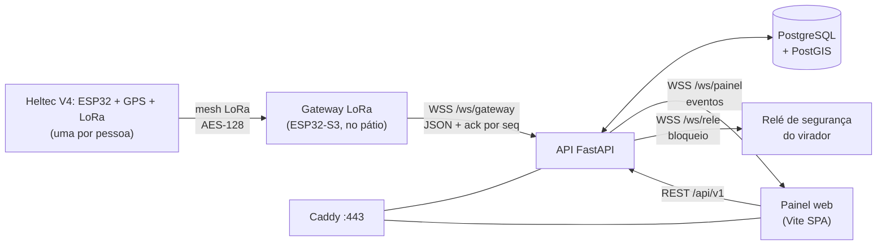

<div align="center">


# GUARÁ — Posicionamento Operacional Inteligente

**Gestão Unificada de Alocação e Revezamento Ágil**

Saber, em tempo real, onde está cada maquinista e manobrista no pátio — e quem chega mais rápido a cada frente de trabalho.


*Desafio **KaizenDO** · Vale · Terminal Ferroviário de Ponta da Madeira (TFPM), São Luís/MA*

</div>

---

> **EN:** GUARÁ is a 5-day prototype for Vale's KaizenDO innovation challenge at the Ponta da Madeira rail terminal (São Luís, Brazil). About 50 locomotive drivers and ground crew work across 13 km of yard and nobody knows exactly where each one is. Each person carries an ESP32 tag with GPS and a radio, gateways forward the positions to an API, and a web panel shows who is where, who can reach a work front fastest and a history for the shift. **What is built here is the web panel (illustrative data) and an API skeleton**; the hardware and the safety relay are the proposed design.

## Demonstração

<div align="center">
  <video src="https://github.com/EnzoFrazao/guara-app/raw/main/docs/video/guara-demo.mp4" poster="docs/img/guara-demo-capa.jpg" controls muted width="720">
    Seu navegador não toca o vídeo aqui. <a href="https://github.com/EnzoFrazao/guara-app/raw/main/docs/video/guara-demo.mp4">Abra o arquivo</a>.
  </video>
</div>

> 42 s, do dispositivo no pátio até a tela do painel. Se o player não aparecer, [abra o vídeo direto](https://github.com/EnzoFrazao/guara-app/raw/main/docs/video/guara-demo.mp4) (o GitHub não mostra `.mp4` na página do arquivo). Os nomes e as posições mostrados são **fictícios**.

<table>
  <tr>
    <td align="center"><b>Dashboard</b></td>
    <td align="center"><b>Mapa ao vivo</b></td>
    <td align="center"><b>Histórico</b></td>
  </tr>
  <tr>
    <td></td>
    <td></td>
    <td></td>
  </tr>
</table>

## O problema

Cerca de **50 maquinistas e manobristas por turno** trabalham em **13 km de pátio**, e ninguém sabe com precisão onde cada um está. A escolha de quem acionar e o revezamento dependem da memória de quem coordena, e os vagões ficam parados esperando gente chegar.

## A solução

Cada pessoa leva uma tag **ESP32** (Heltec V4, com GPS e rádio LoRa) presa ao EPI. Os pacotes saltam por uma mesh LoRa até um gateway, e os gateways enviam a latitude, a longitude e a velocidade de todos à API, que guarda tudo e empurra ao painel. Com isso o sistema:

- 📍 **mostra onde está cada pessoa**, num mapa do pátio atualizado ao vivo;
- ⚡ **recomenda quem chega mais rápido** a cada frente de trabalho *(proposto)*;
- 🕑 **guarda o histórico** de posições do turno;
- 🛑 **bloqueia o virador** quando há alguém na área de basculamento, como extra de segurança *(proposto)*. Se o sinal de quem estava na área se perde, o sistema **assume que a pessoa continua lá** e mantém o bloqueio.

## O que existe hoje

| Parte | Situação |
|---|---|
| Painel web: dashboard, mapa ao vivo, histórico e cadastro | ✅ Implementado como **protótipo visual**, com dados ilustrativos |
| Tema claro e escuro, VLibras (Libras), layout de celular | ✅ Implementado |
| API FastAPI: `/health` e os três WebSockets (gateway, painel, relé) | 🟡 **Esqueleto** funcionando, com autenticação e ack |
| Demais rotas REST, persistência, login, regras de alerta e bloqueio | 🔴 Declaradas, respondem `501`; falta construir |
| Tag Heltec V4, mesh LoRa, gateway e relé de segurança (firmware em C++) | 🔴 Proposto, não construído |

## Telas

| Tela | Rota | O que responde |
|---|---|---|
| **Dashboard** | `/dashboard` | Quem está em campo, em que status, quais alertas (área de risco, pessoa isolada, bateria baixa). Atualiza a cada 5 s |
| **Mapa ao vivo** | `/mapa` | Onde está cada pessoa nos trechos entre os "X" do pátio, com a área de cobertura calculada |
| **Histórico** | `/historico` | Posições passadas, com filtros |
| **Cadastro** | `/cadastro` | Vínculo pessoa ↔ ESP32 (avulso, pelo estoque, ou por um assistente de novo cadastro) |

O protótipo não tem tela de login: quem abre a URL já vê o painel. Na homologação todas as rotas da API exigem login (JWT, perfis `analista`, `seguranca` e `admin`), e a tela de login ainda precisa ser feita. O operário não é usuário do sistema — ele entra como dado, pela tag que carrega.

### Destaques do painel

- 🌗 **Dois temas.** Claro, com as cores oficiais da Vale (padrão de quem visita), e escuro, para o CCO em sala de pouca luz. O mapa **não muda de cor** entre os dois.
- ♿ **Acessibilidade.** Contraste AA no tema claro e tradução para **Libras** com o widget VLibras em todas as telas.
- 📱 **Feito para o celular.** Abas embaixo, tabelas que viram cartões e filtros recolhíveis; muita gente abre o painel por QR code.
- 🗺️ **Mapa sem sobreposição.** A cobertura usa o menor raio que conecta todo mundo (em vez de um raio fixo que cobriria o pátio inteiro) e os pontos são afastados na tela, porque quem coordena precisa ver cada pessoa.

## Arquitetura



- **Uma porta só.** O Caddy atende a 443 e repassa `/api` e `/ws` à API; o painel é estático. Banco e API nunca ficam expostos para fora.
- **Sem broker.** Gateway, relé e painel falam com a API por WebSocket, e o que o MQTT fazia sozinho passa a ser código nosso. **Já existe** no back-end o ack por `id` e `seq` e o descarte de leitura repetida (em memória). **Propostos, ainda não construídos:** reenvio sem ack em 10 s e fila sem internet (no gateway), ping a cada 20 s com gateway offline após 60 s sem resposta, e o relé abrir sozinho após 15 s sem sinal de vida do servidor. Os tempos são proposta para a demonstração.

## Fluxo de ponta a ponta

Cada leitura passa por nove etapas; cada uma recebe algo, faz uma coisa só e entrega adiante.

| # | Onde | O que acontece | Situação |
|---|---|---|---|
| 1 | Tag (Heltec V4, no EPI) | A cada 30 s monta um pacote com id, sequência, hora UTC, lat, lon, velocidade, satélites, HDOP e, se houver, bateria e queda (IMU) | 🔴 Proposto |
| 2 | Mesh LoRa | O pacote salta de vizinho em vizinho até um gateway (criptografado com AES-128) e pode chegar duplicado | 🔴 Proposto |
| 3 | Gateway LoRa (ESP32-S3) | Decifra, descarta duplicados pela sequência, converte em JSON e mantém um WSS aberto com a API; sem internet, guarda em fila | 🔴 Proposto |
| 4 | API: porta de entrada | Aceita só com o token do gateway e responde `ack` a cada mensagem | 🟡 Esqueleto feito |
| 5 | API: ingestão | Valida o JSON, descarta leitura ruim (menos de 4 satélites ou HDOP alto), acha a pessoa vinculada e o trecho (PostGIS) e grava | 🟡 Só valida o JSON; o resto falta |
| 6 | API: regras | Infere o estado (parado, deslocando, embarcado), verifica cercas de risco, pessoa isolada e dispositivo sem sinal (3 envios perdidos = 90 s) e gera alerta ou bloqueio | 🔴 Falta |
| 7 | API: tempo real | Empurra cada mudança aos painéis abertos por `/ws/painel` | 🟡 Só o evento `posicao` |
| 8 | Painel | Move o ponto no mapa e acende alertas; o analista aciona, reconhece alerta ou libera bloqueio por REST | 🟡 Visual com dados ilustrativos; WebSocket só com `VITE_WS_URL` |
| 9 | Registro e aprendizado | Guarda hora prevista e real de cada acionamento; um job noturno recalcula o tempo típico entre trechos (mediana e percentil 90) | 🔴 Falta |

No bloqueio da área de basculamento, a etapa 6 também manda um comando ao controlador do relé por `/ws/rele`. Na homologação isso é só demonstração (LED, buzzer e relé de bancada); ligar ao virador real depende da engenharia e da segurança da Vale.

Contrato da leitura (uma mensagem JSON por leitura, com o código do dispositivo) e a resposta, como o back-end valida hoje:

```json
{"tipo":"telemetria","v":1,"id":"ESP32-0A1B","seq":1842,"ts":"2026-11-11T14:03:30Z","lat":-2.57120,"lon":-44.37010,"vel":4.8,"alt":12,"sats":9,"hdop":0.9,"bat":78,"gw":"GW-01","rssi":-97}
{"tipo":"ack","id":"ESP32-0A1B","seq":1842}
```
- **Rota não acessa banco; regra não fica na rota.** Cada módulo da API segue `router → service → repository`, e um módulo só fala com outro pelo `service`.

## Stack

| Camada | Tecnologias |
|---|---|
| **Painel** (`frontend/`) | Vite, React 19, TypeScript, Tailwind 4, React Router, TanStack Query, Leaflet, WebSocket do navegador, Vitest |
| **API** (`backend/`) | Python 3.12, FastAPI, Uvicorn, Pydantic, SQLAlchemy 2, Alembic, GeoAlchemy2, JWT + Argon2, pytest, ruff |
| **Cálculo** (declarado, ainda sem uso no código) | Shapely (cercas) e SciPy (algoritmo húngaro do revezamento) |
| **Dados** | PostgreSQL 16 com PostGIS (12 tabelas modeladas, sem migração ainda) |
| **Campo** (proposto) | Tag Heltec V4 e gateway LoRa com ESP32-S3, firmware em C++ (Arduino ou ESP-IDF) |
| **Infra** (`docker-compose.yml`) | Docker Compose: Caddy (HTTPS automático), API e banco numa VM Linux só (Ubuntu 24.04, 2 vCPU, 4 GB) · GitHub Actions |

## Como rodar

### Painel

```bash
cd frontend
npm install
npm run dev
```

Abra http://localhost:5173. Para o painel receber eventos em tempo real, defina `VITE_WS_URL` (ex.: `ws://localhost:8000/ws/painel`) num `.env.local`; sem ela, ele segue só com os dados ilustrativos. O cadastro fica no `localStorage` do navegador, e em `/cadastro` o botão "Restaurar dados originais" volta ao estado inicial.

### API (Python 3.12)

```bash
cd backend
python -m venv .venv
.venv/Scripts/activate   # Linux/macOS: source .venv/bin/activate
pip install -e ".[dev]"
cp .env.example .env     # preencha os segredos
uvicorn app.main:app --reload
```

Abra http://localhost:8000/docs. O `GET /api/v1/health` responde `503` enquanto não houver um PostgreSQL com PostGIS em `DATABASE_URL`. Com o painel em `npm run dev`, `/api` e `/ws` já são repassados à porta 8000.

### Homologação com Docker

```bash
cd frontend && npm ci && npm run build && cd ..
cp backend/.env.example .env   # defina POSTGRES_PASSWORD e os segredos
docker compose up -d --build
```

> ⚠️ Este caminho ainda **não foi verificado de ponta a ponta**. O `docker build` da API passa no CI; faltam o `docker compose up`, o Caddy e a migração do banco.

## Testes e qualidade

| Onde | Comando | O que cobre |
|---|---|---|
| `frontend/` | `npm run lint` | ESLint com typescript-eslint e regras de hooks |
| `frontend/` | `npm test` | Vitest: cobertura do mapa, validações de cadastro, tempo real |
| `frontend/` | `npm run build` | `tsc -b` estrito + `vite build` |
| `backend/` | `ruff check .` | Lint |
| `backend/` | `pytest -q` | Segurança (JWT, Argon2), rotas e perfis, WebSockets (recusa sem token, ack, leitura repetida) |

O CI (`.github/workflows/ci.yml`) roda tudo isso e constrói a imagem da API. As telas em si são conferidas à mão no navegador; não há teste de componente nem E2E.

## A API em poucas linhas

- **REST** em `/api/v1`, com JWT e três perfis (`analista`, `seguranca`, `admin`). Só `/health` está pronto; as demais rotas existem e respondem `501`.
- **`/ws/gateway`** exige token do gateway, valida cada leitura JSON e responde `{"tipo":"ack","id","seq"}`. Uma leitura repetida recebe o ack, mas não vai ao painel.
- **`/ws/painel`** exige o JWT de login e recebe o evento `posicao` a cada leitura nova. Os outros quatro eventos do contrato (`dispositivo_status`, `alerta`, `bloqueio`, `acionamento`) ainda não são emitidos. O navegador não envia cabeçalho no WebSocket, então hoje o JWT vai em `?token=` na URL, que pode aparecer em logs; como passar o token é decisão em aberto.
- **`/ws/rele`** exige o token do controlador do relé e fica esperando: o envio de bloquear/liberar e o sinal de vida ainda não existem.
- **Login:** o JWT dura 15 min e a proposta é renovar com cookie httpOnly. As rotas `/auth/*` existem, mas respondem `501`.

## Estrutura

```
frontend/              painel (Vite SPA)
  index.html             HTML único: metas, script do tema, VLibras
  src/main.tsx           entrada: TanStack Query + React Router
  src/app/               Shell, rotas e uma pasta por tela (dashboard, mapa, historico, cadastro)
  src/components/        barra lateral, navegação de celular, filtros, cartões
  src/lib/               dados, consultas (TanStack Query), tempo real (WebSocket), rótulos
backend/               API FastAPI
  app/core/              configuração, JWT e Argon2
  app/db/                base e sessão do SQLAlchemy
  app/modulos/           auth, pessoas, dispositivos, areas, posicoes,
                         acionamentos, alertas, tempo_real
  alembic/               migrações (ainda sem a inicial)
  tests/                 pytest
docs/                  imagens das telas e o vídeo de demonstração
docker-compose.yml     Caddy + API + PostGIS
Caddyfile              HTTPS, /api e /ws para a API, painel estático
.github/workflows/     CI
```

## Decisões técnicas

- **Tema claro como variante aditiva.** Cada elemento mantém a classe do escuro e *ganha* uma `claro:` ao lado; o escuro é imutável por construção. O claro é o padrão de quem visita.
- **SPA em Vite, sem servidor Node.** A homologação não tem servidor Node, e a stack acordada é Vite + React Router + TanStack Query. As telas desmontam ao navegar, então filtros digitados não persistem ao voltar.
- **Contraste AA no claro.** O cinza oficial da Vale não passa em AA para texto, então o tema claro usa tons mais escuros (grafite e ardósia).
- **WebSocket, sem MQTT, na versão final.** O MQTT ficou só no teste de bancada (broker público); na homologação gateway, relé e painel falam com a API por WebSocket.
- **Posição a cada 30 s.** A pé, uma pessoa anda cerca de 40 m em 30 s, bem menos que um trecho de 1,5 km, e o intervalo maior economiza bateria e rádio.
- **Falha segura no bloqueio.** Perdeu o sinal de quem estava na área? O bloqueio continua.
- **Liberar um bloqueio exige confirmação humana** (perfil `seguranca`).

## Limitações e próximos passos

- Os dados do painel são **ilustrativos**; ligar o painel à API (REST) e criar o login são os próximos passos.
- Persistência, migração inicial do banco, regras de alerta e de bloqueio, ranking de acionamento e job noturno ainda não existem.
- As coordenadas dos trechos "X" divergem do diagrama oficial do pátio e aguardam pontos levantados em campo.
- O layout de celular só foi conferido em viewport emulado; falta um aparelho real.
- A homologação depende de respostas da TI da Vale (rede do gateway, banco, login corporativo, retenção de dados e relé).

## Documentação

Este repositório guarda só o código. O contexto do desafio (problema, solução, especificação das telas, fotos da visita de campo), a memória técnica (`specs/`, com ADRs) e o material de apresentação ficam na pasta `documentos/` do projeto, fora do Git. Cada pasta de tela do painel tem um README próprio (`frontend/src/app/<tela>/README.md`).

## Time

Desenvolvido durante a imersão de cinco dias do KaizenDO na Estrada de Ferro Carajás, com visita de campo ao terminal.

**Sponsor:** Lizandro Terceiro · **Especialistas:** Fernando Nunes, Andressa Chaves-Tharjes Lima, Rogerio Pereira · **Estagiário:** Itaio Conceição · **SESI:** Maria Alice · **Universitários:** Enzo Frazão (líder da equipe), Grazielli Diniz, Luick Vieira

Desenvolvido com apoio de agentes de IA (Claude Code), guiado por specs e decisões registradas.
